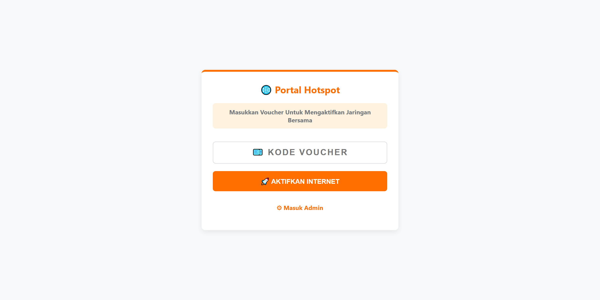
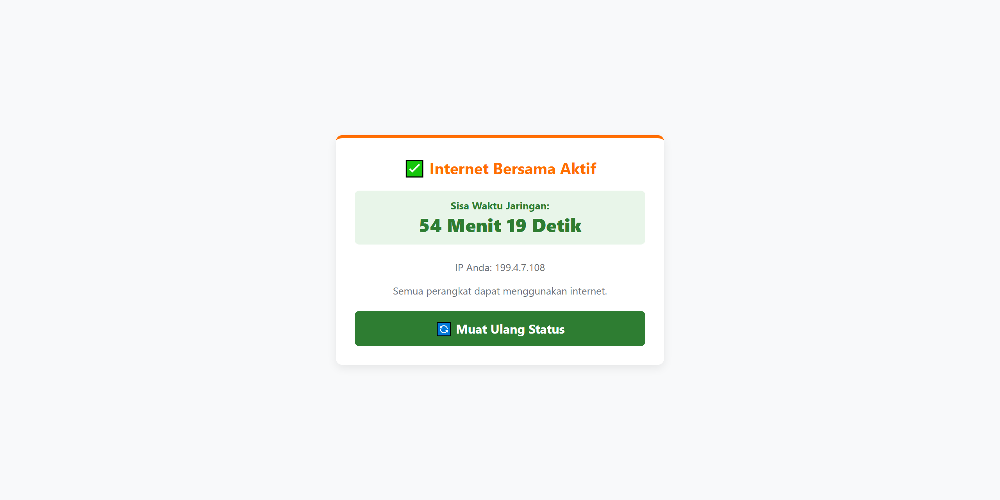
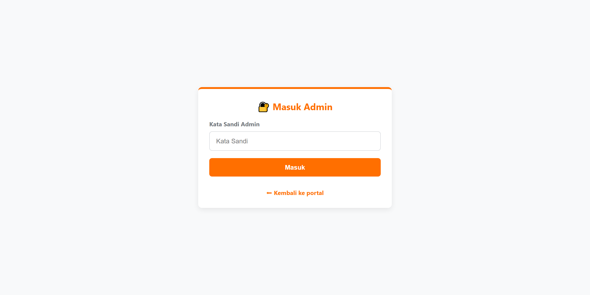
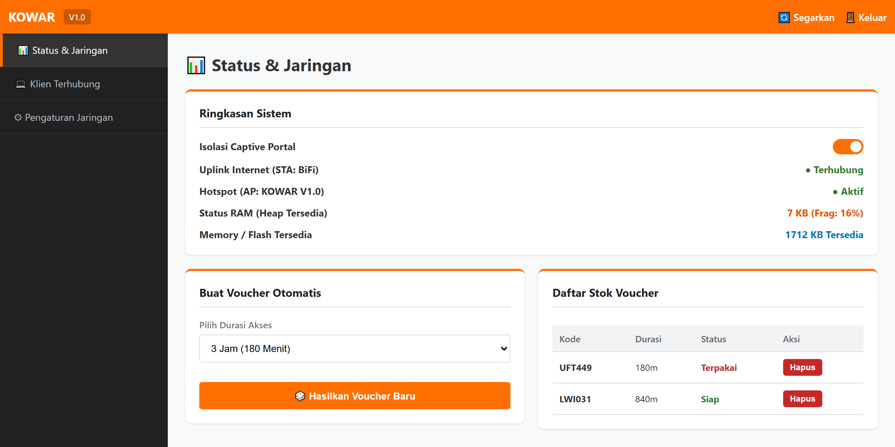
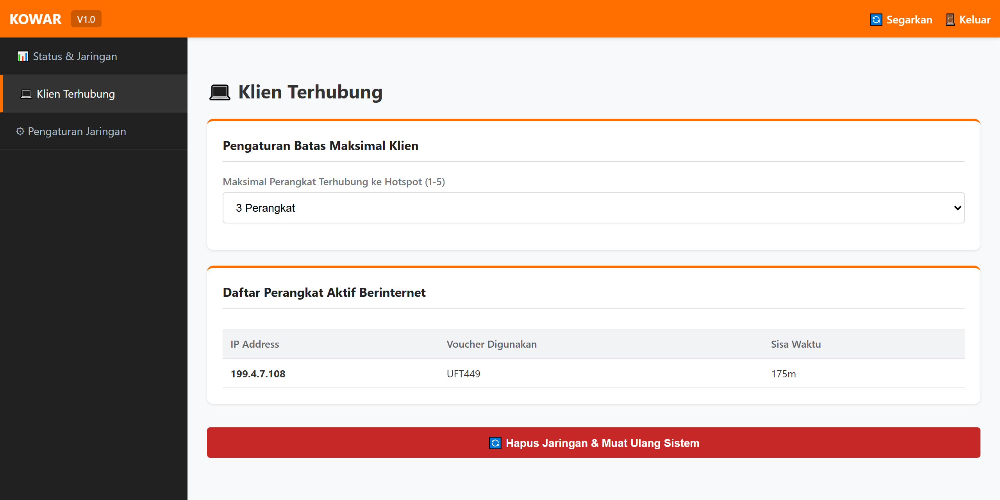
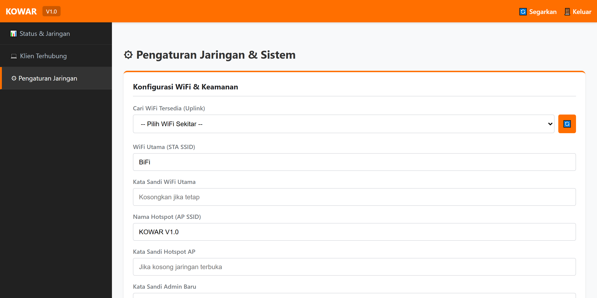
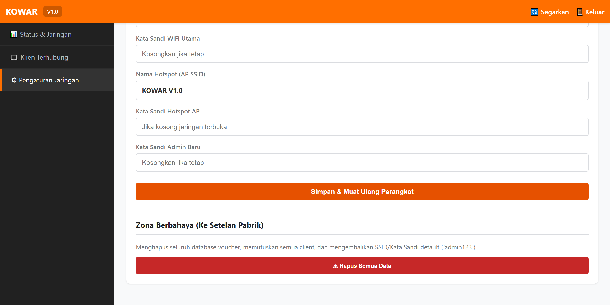

# KOWAR (Koneksi Warga)
Adalah solusi perangkat lunak router/repeater berbasis mikrokontroler yang mengubah jaringan WiFi menjadi portal hotspot sewa internet terintegrasi.

## Sumbangan
Terimakasih untuk orang baik.


## Screenshot
<table style="width: 100%; border: none;">
  <tr>
    <td align="center" style="border: none;">
      
    </td>
    <td align="center" style="border: none;">
      
    </td>
    <td align="center" style="border: none;">
      
    </td>
  </tr>
</table>

<table style="width: 100%; border: none;">
  <tr>
    <td align="center" style="border: none;">
      
    </td>
    <td align="center" style="border: none;">
      
    </td>
    <td align="center" style="border: none;">
      
    </td>
    <td align="center" style="border: none;">
      
    </td>
  </tr>
</table>

## Diagram
```txt
+-----------------------+    Koneksi WiFi (STA)     +--------------------------+
|  Router Utama / ISP   | ------------------------> | Wemos D1 Mini ESP8266    |
|  (Sumber Internet)    |                           | (KOWAR V1.0 Repeater)    |
+-----------------------+                           +--------------------------+
                                                                  |
                                                                  | Captive Portal / AP
                                                                  | (Tanpa Pass / Ber-Pass)
                                                                  v
                                                    +--------------------------+
                                                    |    Client / User         |
                                                    |    (HP / Laptop Warga)   |
                                                    +--------------------------+
```

Menggunakan Wemos D1 Mini ESP8266 sebagai otak utama perangkat keras, KOWAR V1.0 mengubah modul WiFi murah meriah ini menjadi router hotspot mandiri layaknya mikrokontroler profesional berfitur lengkap.

Keunggulan Perangkat Keras & Sistem:

- Optimasi Hardware ESP8266: Memanfaatkan memori dan fitur NAPT (Network Address Port Translation) secara efisien dengan arsitektur Global Session Timer, memastikan perangkat berjalan stabil tanpa crash atau lag.
- Manajemen Voucher Terpusat: Sistem sewa internet fleksibel (mulai dari 1 jam hingga 12 jam) yang dikelola langsung di dalam memori EEPROM internal.
- Captive Portal: Setiap perangkat yang terhubung ke WiFi dapat mengunjungi portal lokal (199.4.7.9) untuk memasukan kode voucher atau melihat countdown sisa waktu.
- Panel Admin Web-Based: Antarmuka modern bergaya sPanel ID style untuk membuat voucher, memantau client, scan jaringan sekitar, hingga melakukan factory reset langsung dari HP atau Laptop.

## Konfigurasi Awal :
```c++
strcpy(config.staSSID, "KOWAR-KOWAR");
strcpy(config.staPASS, "admin123");
strcpy(config.apSSID,  "KOWAR V1.0");
strcpy(config.apPASS,  "admin123");
String defaultHash = getSHA256("admin123");
```
Semua data disimpan di EEPROM perangkat.

## Batasan Terhubung
Kami membatasi perangkat yang terhubung dengan maksimal 3, jika melebihi dari itu perangkat menolak berjabat tangan dengan pengguna ke 4. Dan untuk kode voucher anda dapat membuat dengan maksimal 5 sesuaikan nama kode dan waktu untuk terkoneksi.

## Cara Pasang Firmware (.bin)
Pastikan anda sudah memasang driver [CH304](https://www.wemos.cc/en/latest/ch340_driver.html) di komputer anda.

Unduh firmware [KOWAR V.1 WEMOS D1 MINI ESP8266](https://github.com/spanelweb/kowar/raw/refs/heads/main/wemos_d1_mini_esp8266_kowar_v1.bin) dan flashtool [esp8266flasher EXE 32bit](https://github.com/nodemcu/nodemcu-flasher/blob/master/Win32/Release/ESP8266Flasher.exe?raw=true) atau [esp8266flasher EXE 64bit](https://github.com/nodemcu/nodemcu-flasher/raw/refs/heads/master/Win64/Release/ESP8266Flasher.exe?raw=true) sesuaikan dengan komputer anda.
```txt
  Flash
  Buka esp8266flasher.exe
  ----------------------------
  Advanced
  115200
  4Mb
  80Mhz
  DOUT
  ----------------------------
  Config
  Dir YOUR-LOCAL-PC/wemos_d1_mini_esp8266_kowar_v1.bin    |    0x00000
  ----------------------------
  Operation
  Your Port Ex.COM1 ---> Flash(F)
```

## Catatan
> Firmware tidak untuk diperjual belikan kembali atau diproduksi dalam jumlah banyak untuk di perdagangkan, bukan source code yang diberikan, jadi jangan pernah membahas/meminta kode mentah! Peraturan ini sudah ditetapkan. Kami hanya akan mengajarkan dan memberikan firmware secara online, dan juga untuk perakitan atau penginstalan firmware sampai KOWAR V.1 dapat dijalankan (termasuk standar penggunaan).

## Bug?
Issue sidebar tidak bisa klik : Lakukan pememuatan ulang langsung dari perangkat Wemos-nya dengan tekan tombol di samping (RESET), lalu coba kembali koneksikan, segarkan halaman panel dasbor admin.

<hr/>

Platform Hardware: Wemos D1 Mini (ESP8266)

Pengembang: Suryo Dwijayanto © 2026
